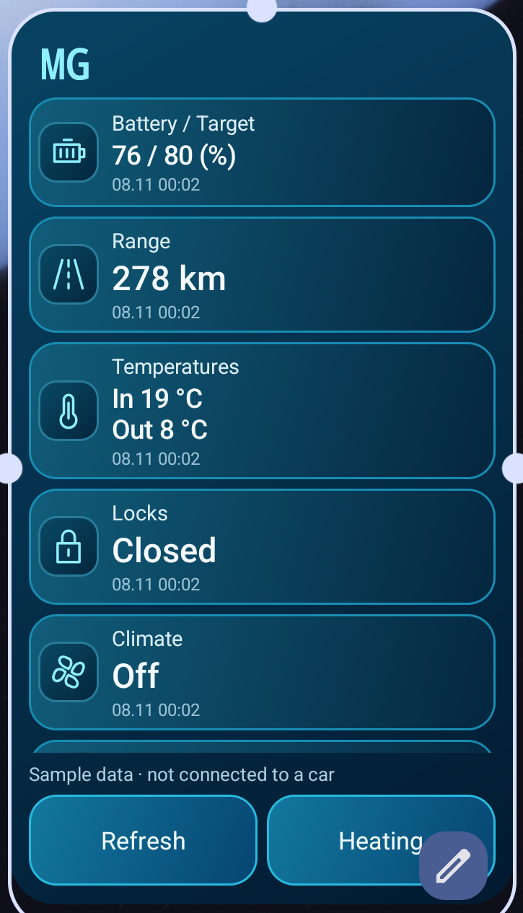
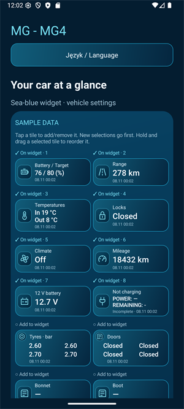

# MG4 Widget

**Download APK 0.8.0:** [MG4-Widget-0.8.0-debug.apk](https://github.com/uberArius/mg4-widget/releases/latest/download/MG4-Widget-0.8.0-debug.apk)

---

## English

An independent Android app and home-screen widget for MG iSMART vehicles (EU/UK and AU/NZ). It talks directly to the iSMART API — no MQTT broker and no personal server. The UI is available in Polish and English.

### Screenshots





### Features

- Configurable sea-blue home-screen widget: choose, order and scroll tiles; hide icons or action buttons; one or two columns.
- 25 reading tiles: battery, range, temperatures, locks, climate, mileage, 12 V, charging (power and remaining time), SOC target, tyres, doors/windows, charging schedule, bonnet, boot, sunroof, lights, handbrake and drive.
- Charging tile: `POWER` (kW) and `REMAINING` (min), titled "Charging" (red), "Not charging" (blue) or "Unknown state".
- Battery / Target tile: e.g. `56 / 80 (%)`.
- Alerts: red widget background for low tyre pressure, unlocked locks or open doors/windows/bonnet/boot when drive is OFF.
- Refresh: manual, periodic every 15–60 minutes, and after disconnecting a selected car Bluetooth device.
- Cabin-heating profile (17–31 °C, windscreen mode, seat heating) verified against later readings.
- Diagnostic report of known vehicle fields from raw API responses, without passwords or tokens.
- Polish/English with automatic system-language detection and a manual switch.
- Demo mode without an account; sample data is labelled.
- Credentials and tokens encrypted locally (AES-GCM / Android Keystore).

### Requirements

- Android 12 or later (`minSdk 31`), `compileSdk`/`targetSdk` 36
- JDK 17+
- Android SDK — path in `local.properties` (key `sdk.dir`)
- Gradle 8.13 (wrapper included)

### Building

```powershell
./gradlew.bat :app:assembleDebug
```

Output: `app/build/outputs/apk/debug/app-debug.apk` (debug-signed).

```powershell
./gradlew.bat :app:testDebugUnitTest
./gradlew.bat :app:lintDebug
```

### Repository structure

- `app/` — application code
- `publication/mg4-widget/` — public materials (description, installation, risks, third-party licenses)
- `docs/` — technical notes, validation and screenshots
- `reference/` — external reference projects (not part of the app)
- `tools/` — helper scripts

### License and attribution

Application code and assets are proprietary — see [LICENSE.md](LICENSE.md). The source is published for transparency and evaluation; no license to copy or modify it is granted. Third-party components remain under their own licenses; see [THIRD_PARTY_NOTICES.txt](THIRD_PARTY_NOTICES.txt) and `publication/mg4-widget/licenses/`.

The integration adapts [saic-python-client-ng](https://github.com/SAIC-iSmart-API/saic-python-client-ng) and [saic-python-mqtt-gateway](https://github.com/SAIC-iSmart-API/saic-python-mqtt-gateway) (MIT; notices preserved).

### Disclaimer

Independent, unofficial, experimental software. Not affiliated with or endorsed by MG/SAIC. Use and iSMART connection at your own risk — read [publication/mg4-widget/RISKS.md](publication/mg4-widget/RISKS.md).

---

## Polski

Niezależna aplikacja na Androida z widżetem ekranu głównego dla samochodów MG obsługiwanych przez iSMART (Europa/UK oraz Australia/NZ). Łączy się bezpośrednio z API iSMART — bez MQTT, bez własnego serwera i bez pośredników. Interfejs jest dostępny po polsku i angielsku.

### Zrzuty ekranu


### Funkcje

- Konfigurowalny widżet „MG · morski”: wybór, kolejność i przewijanie kafelków, ukrywanie ikon i przycisków, jedna lub dwie kolumny.
- 25 kafelków: bateria, zasięg, temperatury, zamki, klimatyzacja, przebieg, 12 V, ładowanie (moc i czas do końca), cel SOC, opony, drzwi/szyby, plan ładowania, maska, bagażnik, szyberdach, światła, hamulec postojowy i napęd.
- Kafelek ładowania: `MOC` (kW) i `KONIEC` (min), tytuł „Trwa ładowanie” (czerwony), „Nie ładuje” (niebieski) lub „Stan nieznany”.
- Kafelek Bateria / Cel: np. `56 / 80 (%)`.
- Alarmy: czerwone tło widżetu przy niskim ciśnieniu opon, odblokowanych zamkach lub otwartych drzwiach/szybach/masce/bagażniku, gdy napęd jest wyłączony.
- Odświeżanie: ręczne, okresowe co 15–60 minut oraz po rozłączeniu wybranego BT samochodu.
- Profil ogrzewania (17–31 °C, tryb szyby, fotele) weryfikowany na podstawie kolejnych odczytów.
- Diagnostyka znanych pól pojazdu z surowych odpowiedzi API, bez haseł i tokenów.
- Polski/angielski z automatycznym wyborem po języku systemu i ręcznym przełącznikiem.
- Tryb demonstracyjny bez konta; dane oznaczone jako przykładowe.
- Dane logowania i tokeny szyfrowane lokalnie (AES-GCM / Android Keystore).

### Wymagania

- Android 12+ (`minSdk 31`), `compileSdk`/`targetSdk` 36
- JDK 17+
- Android SDK — ścieżka w `local.properties` (klucz `sdk.dir`)
- Gradle 8.13 (wrapper w repozytorium)

### Budowanie

```powershell
./gradlew.bat :app:assembleDebug
```

Wynik: `app/build/outputs/apk/debug/app-debug.apk` (podpisany kluczem debug).

```powershell
./gradlew.bat :app:testDebugUnitTest
./gradlew.bat :app:lintDebug
```

### Struktura repozytorium

- `app/` — kod aplikacji
- `publication/mg4-widget/` — publiczne materiały (opis, instalacja, ryzyka, licencje stron trzecich)
- `docs/` — notatki techniczne, walidacje i zrzuty ekranów
- `reference/` — zewnętrzne projekty referencyjne (nie są częścią aplikacji)
- `tools/` — skrypty pomocnicze

### Licencje i atrybucja

Kod i zasoby aplikacji są zastrzeżone — zobacz [LICENSE.md](LICENSE.md). Kod źródłowy jest udostępniany do wglądu i oceny; nie udziela się licencji na jego kopiowanie ani modyfikowanie. Komponenty zewnętrzne pozostają na własnych licencjach — zobacz [THIRD_PARTY_NOTICES.txt](THIRD_PARTY_NOTICES.txt) oraz `publication/mg4-widget/licenses/`.

Integracja adaptuje fragmenty [saic-python-client-ng](https://github.com/SAIC-iSmart-API/saic-python-client-ng) i [saic-python-mqtt-gateway](https://github.com/SAIC-iSmart-API/saic-python-mqtt-gateway) (MIT; informacje zachowane).

### Zastrzeżenie

Niezależne, nieoficjalne i eksperymentalne oprogramowanie. Nie jest powiązane z MG ani SAIC i nie jest przez nie wspierane. Korzystanie oraz łączenie z iSMART na własne ryzyko — przeczytaj [publication/mg4-widget/RISKS.md](publication/mg4-widget/RISKS.md).
