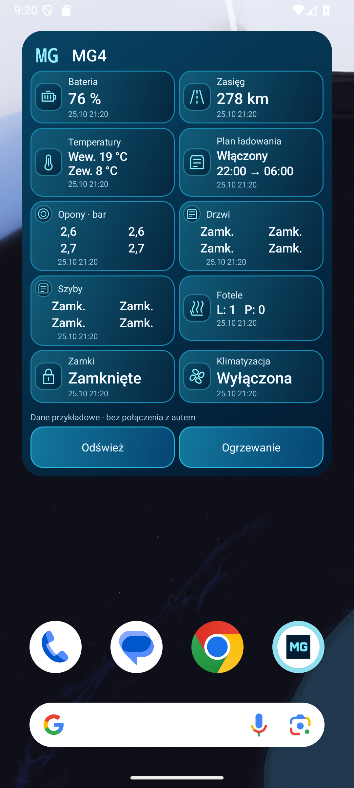

# MG4 Widget

**An independent Android home-screen widget for MG iSMART vehicles.**

[Download test APK](https://github.com/uberArius/mg4-widget/releases/tag/v0.5.0) · [Description — ENG / PL](DESCRIPTION.md) · [Installation & guide — ENG / PL](INSTALLATION.md) · [Risks — ENG / PL](RISKS.md)

> **Experimental, unofficial software.** Read [the risks](RISKS.md) before installing or connecting an account. Service access may be removed at any time. Prefer an additional iSMART account to avoid session conflicts with the manufacturer's app.
>
> **Test expiry: 25 November 2026, 00:00 UTC** (01:00 in Poland). iSMART connections stop after this date; install a newer build to continue. The deadline is tied to this release, not your installation date.

## At a glance

- One configurable sea-blue widget: choose and reorder tiles, hide icons or action buttons, resize to one or two columns.
- Battery, range, cabin/outside temperatures, tyre pressures, doors, windows, seats, charging schedule and more — depending on vehicle/API availability.
- Manual refresh from the widget, optional 15–60 minute background refresh, and refresh after disconnecting a selected car Bluetooth device.
- A cabin-heating profile with a confirmation screen; the app checks subsequent vehicle readings instead of assuming a command succeeded.
- Local diagnostic report of known vehicle fields, including missing responses.
- No MQTT broker or personal server required. Credentials are stored encrypted on the phone.

## Current release

**0.5.0 — public testing prerelease.** Android 12 or later (API 31+). The app currently has a Polish interface; first-use risk acceptance is available in Polish and English. Documentation is bilingual.

Intended initial test vehicle: MG4 XPOWER 2024, Europe. EU/UK and AU/NZ server selection is implemented, but all regions, vehicles and shared-account permissions are **not** field-verified. Other models may expose only some readings; remote controls are limited to recognized MG4/EH32 vehicles.

Login has been reported working by the initial tester. Slow or unavailable vehicle readings remain under investigation. This is not a production-ready or guaranteed replacement for the official app. Android/Samsung battery policies can delay background tasks.

## Preview

Demo data only, from v0.5.0. One-column mode hides the model name. The app icon uses custom angular MG letters, not the manufacturer's emblem.

## Download and install

Open [release v0.5.0](https://github.com/uberArius/mg4-widget/releases/tag/v0.5.0) and download `MG4-Widget-0.5.0-debug.apk`. The build is debug-signed for testing. Follow the [installation guide](INSTALLATION.md), review the risks and accept them on first launch. APKs are release assets, not committed application source.

This repository contains documentation, notices, preview images and download links. **The application source code is not published.** GitHub's automatically generated “Source code” archives contain only this repository's public materials.

## Feedback

Use [Issues](https://github.com/uberArius/mg4-widget/issues) for non-sensitive reports. Include app version, phone/Android version, region, model, operation, elapsed time and the redacted error message. **Never post passwords, tokens, full VINs, account email addresses or location coordinates.**

## License and attribution

Application-specific code remains proprietary; the APK is provided for evaluation under [the test-use terms](LICENSE.md). This is not an MIT license grant for the whole application. Third-party rights remain unchanged.

The integration adapts work from [saic-python-client-ng](https://github.com/SAIC-iSmart-API/saic-python-client-ng) and [saic-python-mqtt-gateway](https://github.com/SAIC-iSmart-API/saic-python-mqtt-gateway), with MIT notices preserved. Runtime dependencies use Apache-2.0; OkHttp includes MPL-2.0 Public Suffix List data. See [full third-party notices](THIRD_PARTY_NOTICES.txt), [dependency inventory](DEPENDENCIES.md) and [license texts](licenses/). These notices are also embedded in the APK.

MG and iSMART identify compatible third-party products/services. This project is not affiliated with, endorsed by or supported by MG/SAIC.
