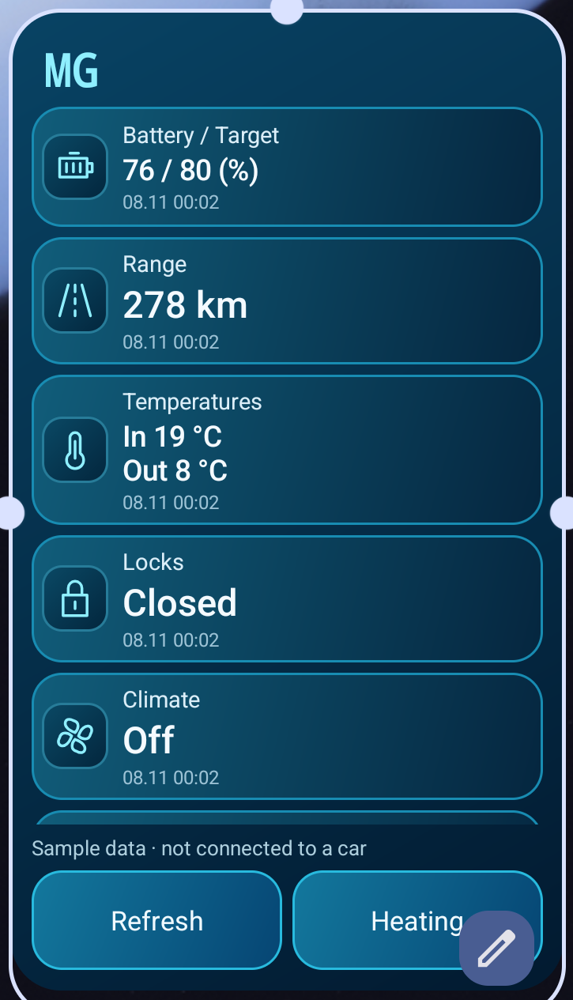
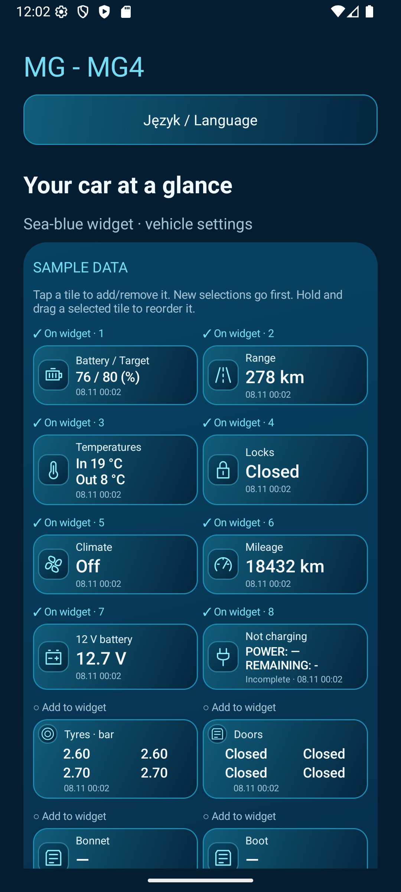

# MG4 Widget

**An independent Android home-screen widget for MG iSMART vehicles.**

[Download latest APK](https://github.com/uberArius/mg4-widget/releases/latest) · [Description — ENG / PL](DESCRIPTION.md) · [Installation & guide — ENG / PL](INSTALLATION.md) · [Risks — ENG / PL](RISKS.md)

> **Experimental, unofficial software.** Read [the risks](RISKS.md) before installing or connecting an account. Service access may be removed at any time. Prefer an additional iSMART account to avoid session conflicts with the manufacturer's app.

## At a glance

- Configurable sea-blue home-screen widget: choose, order and scroll tiles; hide icons or action buttons; one or two columns.
- Battery, charge target, charging power and remaining time, range, temperatures, tyre pressures, locks, doors, windows, seats, charging schedule and more — depending on vehicle/API availability.
- Combined charging tile with `MOC` (battery power, kW) and `KONIEC` (remaining minutes). Title: **Trwa ładowanie / Charging** (red), **Nie ładuje / Not charging** (blue) or **Stan nieznany / Unknown state**.
- Battery / Target tile: `56 / 80 (%)`.
- Red widget background warns of low tyre pressure, unlocked locks or open doors/windows/bonnet/boot when drive state is OFF — even for hidden tiles.
- Manual refresh from the widget, optional 15–60 minute background refresh, and refresh after disconnecting a selected car Bluetooth device.
- Cabin-heating profile with a confirmation screen; later vehicle readings are checked instead of assuming a command succeeded.
- Local diagnostic report of known vehicle fields, including missing responses.
- Polish and English interface: automatic selection from the system language, or a manual **Auto / Polski / English** switch in the menu.
- No MQTT broker or personal server required. Credentials are stored encrypted on the phone.

## Current release

**0.8.0 — public testing prerelease.** Android 12 or later (API 31+). The interface is available in Polish and English, and the test-time restriction has been removed. Documentation is bilingual.

Intended initial test vehicle: MG4 XPOWER 2024, Europe. EU/UK and AU/NZ server selection is implemented, but all regions, vehicles and shared-account permissions are **not** field-verified. Other models may expose only some readings; remote controls are limited to recognized MG4/EH32 vehicles.

This is not a production-ready or guaranteed replacement for the official app. Android/Samsung battery policies can delay background tasks.

## Preview

Screenshots show the English interface with sample (demo) data. Negative battery power is displayed with the sign reported by the data calculation. One-column mode hides the model name. The app icon uses custom angular MG letters, not the manufacturer's emblem.

## Download and install

Open the [latest release](https://github.com/uberArius/mg4-widget/releases/latest) and download `MG4-Widget-0.8.0-debug.apk`. The build is debug-signed for testing. Follow the [installation guide](INSTALLATION.md), review the risks and accept them on first launch. APKs are release assets, not committed application source.

This repository contains the application source code (see `app/`), build files, documentation, notices and preview images. The source is published for transparency and personal evaluation and remains under the terms in [LICENSE.md](LICENSE.md), which is not an open-source license grant.

## Feedback

Use [Issues](https://github.com/uberArius/mg4-widget/issues) for non-sensitive reports. Include app version, phone/Android version, region, model, operation, elapsed time and the redacted error message. **Never post passwords, tokens, full VINs, account email addresses or location coordinates.**

## License and attribution

Application-specific code remains proprietary; the APK is provided for evaluation under [the terms of use](LICENSE.md). This is not an MIT license grant for the whole application. Third-party rights remain unchanged.

The integration adapts work from [saic-python-client-ng](https://github.com/SAIC-iSmart-API/saic-python-client-ng) and [saic-python-mqtt-gateway](https://github.com/SAIC-iSmart-API/saic-python-mqtt-gateway), with MIT notices preserved. Runtime dependencies use Apache-2.0; OkHttp includes MPL-2.0 Public Suffix List data. See [full third-party notices](THIRD_PARTY_NOTICES.txt), [dependency inventory](DEPENDENCIES.md) and [license texts](licenses/). These notices are also embedded in the APK.

MG and iSMART identify compatible third-party products/services. This project is not affiliated with, endorsed by or supported by MG/SAIC.
